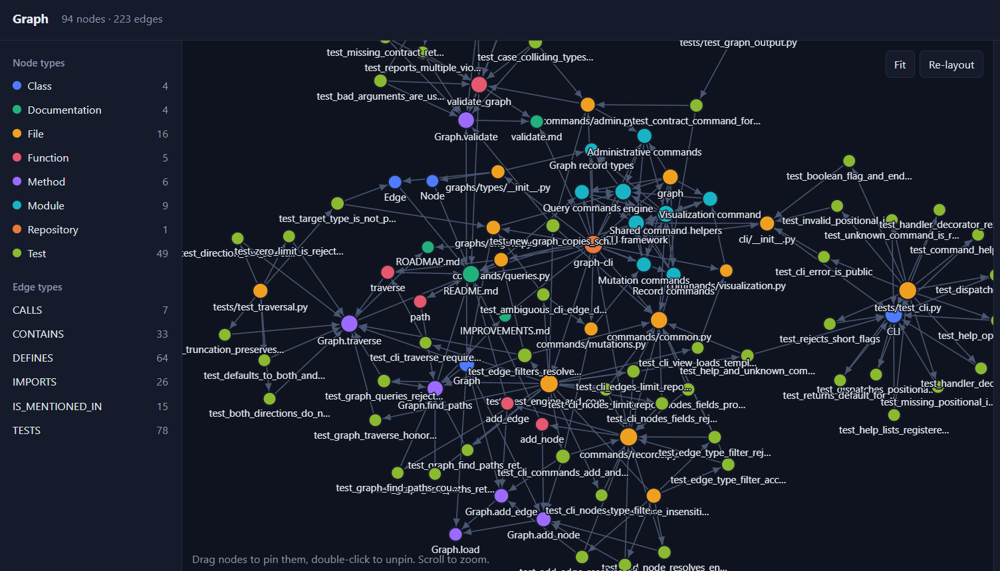
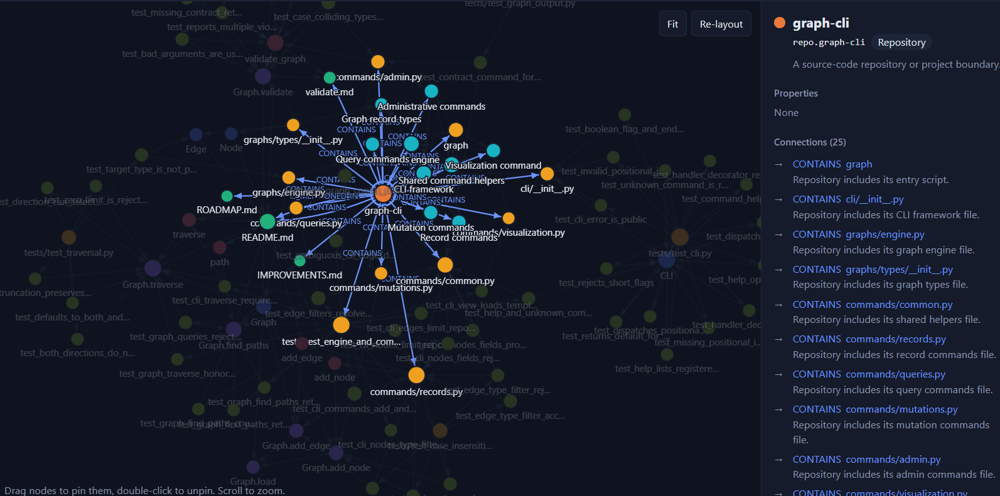
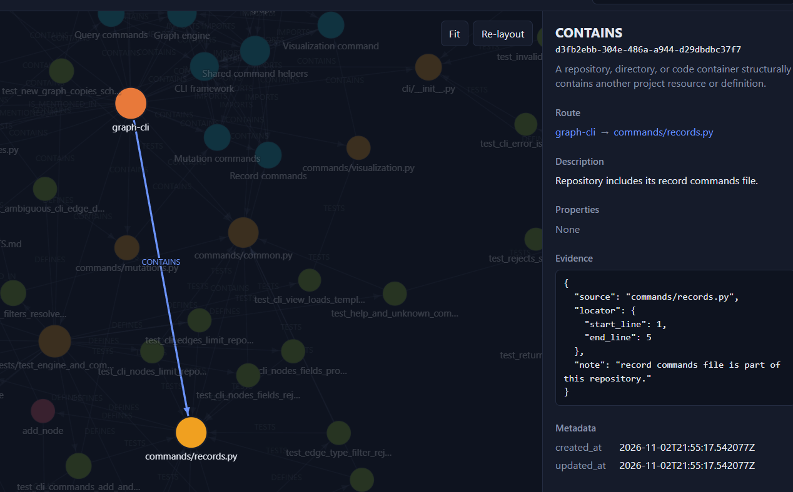

# graph-lcb

A local command-line tool for managing a JSON-backed graph with customizable
entity and edge types. The workspace is stored in `.graph/` under the current
working directory.






## Install

Requires Python 3.10 or newer. Install the CLI directly with:

```sh
pip install graph-lcb
```

This installs the `graph` command. To install the test dependencies and run the
test suite from a local development checkout instead:

```sh
python -m pip install -e ".[test]"
python -m pytest
```

## Workspace and files

Initialize a project explicitly:

```sh
graph init
```

This creates missing starter contract files and copies the bundled JSON
Schemas into `.graph/schemas/`. Existing contracts, schemas, and graph data
are preserved. Initialization does not create `graph.json`; the graph store
is written when a record is first added.

Graph operations do not initialize a workspace implicitly. If `.graph/` or
either contract file is missing, graph operations report that the workspace
must be initialized. `graph validate` reports an uninitialized workspace
without creating files. `graph contract` can display the starter contracts
without creating a workspace.

| Path | Purpose |
| --- | --- |
| `.graph/entities.json` | Entity type definitions and allowed node properties |
| `.graph/edges.json` | Edge type definitions, endpoint constraints, and allowed edge properties |
| `.graph/graph.json` | Persisted `nodes` and `edges` arrays |
| `.graph/schemas/entities.schema.json` | Bundled editor-facing JSON Schema for entity contracts |
| `.graph/schemas/edges.schema.json` | Bundled editor-facing JSON Schema for edge contracts |
| `.graph/view.html` | Generated visualization written by `graph view` |

The contracts and graph store are resolved relative to the process's current
working directory, not the location of the installed CLI. Run commands from
the project whose `.graph/` you intend to access.

## AI agents and skills

When using an AI agent to explore this graph, start with the
[graph-query skill](docs/skills/graph-query/SKILL.md). It guides agents to check
the contract, confirm node IDs, and choose between `nodes`, `edges`, `traverse`,
and `path` queries.

To build a thorough, evidence-backed map of a codebase, use the
[graph-batch-import skill](docs/skills/graph-batch-import/SKILL.md). It guides
agents to gather evidence, prepare one JSONL batch, dry-run it, and import the
complete batch atomically.

You can create additional skills for the tasks and knowledge your project needs,
such as documenting sources, mapping systems, or exploring flows, processes,
infrastructure, and knowledge bases. The graph is flexible: define domain
entities and relationships in the contracts, add typed properties to capture
the details you need, and attach evidence objects to nodes or edges to record
supporting sources or locators. Skills can then guide agents on how to interpret
that model, gather evidence, and query it consistently.

## Contract format

An entity contract maps each entity type to a definition with a `properties`
object. An edge contract additionally defines the allowed source and target
entity types. The starter contracts created by `graph init` are:

```json
{
  "$schema": "./schemas/entities.schema.json",
  "API": {
    "description": "An API or application service",
    "properties": {
      "language": { "type": "string", "required": true }
    }
  }
}
```

```json
{
  "$schema": "./schemas/edges.schema.json",
  "CALLS": {
    "description": "A service synchronously invokes another service or API.",
    "source": ["API"],
    "target": ["API"],
    "properties": {
      "protocol": { "type": "string", "required": false }
    }
  }
}
```

You can add domain-specific types and properties. For example, an entity
contract may define:

```json
{
  "API": {
    "description": "An API or application service",
    "properties": {
      "language": { "type": "string", "required": true },
      "framework": "string",
      "base_url": { "type": "string", "required": false }
    }
  }
}
```

And an edge contract may define:

```json
{
  "CALLS": {
    "description": "One service invokes another.",
    "source": ["API", "WORKER"],
    "target": ["API"],
    "properties": {
      "method": { "type": "string", "required": false }
    }
  }
}
```

Contract rules:

- Each top-level type name maps to a JSON object. Type names are
  case-insensitive when used by commands and must be unique ignoring case.
  The spelling in the contract is canonical for newly created records.
- Each entity requires a `properties` object. Each edge requires `source`,
  `target`, and `properties`. `source` and `target` are lists of entity type
  names; each referenced type must exist. The bundled JSON Schema expects these
  lists to be non-empty.
- `description` is optional at runtime. It describes a type, not an individual
  record. Edge records have their own optional free-form description.
- A property definition is either a shorthand type string, such as
  `"framework": "string"`, or an object with `type` and optional `required`.
  Supported types are `string`, `number`, `integer`, and `boolean`.
  `required` defaults to `false`.
- `number` accepts JSON integers and decimal numbers, but not booleans.
  `integer` accepts integers, but not booleans. Null, arrays, and objects are
  not supported property types.
- The engine checks contract structure, type references, and property rules
  during graph operations and `validate`. The bundled JSON Schema files support
  editor validation and completion; `$schema` is metadata and is omitted from
  `graph contract` output.

## Command conventions

```text
graph <command> [arguments] [options]
```

- Long options use either `--name value` or `--name=value`. Short options such
  as `-n` are not supported.
- Options with comma-separated values accept one or more items without spaces,
  for example `--type=API,WORKER`.
- JSON option values must be valid JSON. The examples below use single quotes
  around JSON, as is customary in POSIX shells; use quoting appropriate for
  your shell.
- `--help` or `-h` prints command help. `graph help` prints the command list;
  `graph help COMMAND` prints a concise technical guide with usage, behavior,
  return shape, and examples. The README remains the full reference.
- `--version` prints the installed `graph-lcb` package version.
- `--` stops option parsing. Arguments after it are treated as positional
  values.
- Commands requiring a graph workspace expect `graph init` to have been run
  first. Help, `init`, `contract`, and `validate` do not require initialization.

## Command reference

### `graph --help`, `graph help`

```text
graph --help
graph help [COMMAND]
```

Print the registered commands, or a concise technical guide for one command.
Command guides include usage, behavior, output shape, and examples. These forms
do not read or create graph files.

### `graph --version`

```text
graph --version
```

Print the installed `graph-lcb` package version.

### `graph init`

```text
graph init
```

Create `.graph/`, starter `entities.json` and `edges.json` files, and missing
bundled schema files under `.graph/schemas/`.

- Takes no positional arguments or options.
- Existing contracts and schemas are never overwritten. Existing
  `.graph/graph.json` is not modified.
- Safe to run again: it fills missing files but preserves existing ones.
- Does not create an empty `graph.json`; a graph store is written when a node
  or edge is added.
- Prints `{"initialized":true,"directory":".graph"}` on success.

### `graph contract`

```text
graph contract [entities|edges] [--compact]
```

Show contract definitions. This command can be used before initialization;
when no workspace contract files exist, it displays the built-in starter
contracts without writing them.

| Parameter | Meaning |
| --- | --- |
| `entities` | Show only entity contracts. `entity` is also accepted. |
| `edges` | Show only edge contracts. `edge` is also accepted. |
| Omitted category | Show both sections. |
| `--compact` | Render text summaries containing type descriptions, edge endpoint types, and property types/required markers instead of JSON. Takes no value. |

Default output is compact single-line JSON: when showing both categories the
top-level keys are `entities` and `edges`; when one category is selected, the
output is that contract object. `$schema` is omitted from this output.
Compact output is plain text, not JSON.

### `graph validate`

```text
graph validate
```

Read-only validation of the current contracts and graph store. It does not
create, rewrite, or repair files. It reports all detected contract and record
violations in one response.

The JSON response has this shape:

```json
{
  "valid": false,
  "errors": [
    {
      "kind": "node",
      "id": "orders-api",
      "code": "missing_required_property",
      "message": "missing required property: language"
    }
  ],
  "summary": {
    "nodes": 1,
    "edges": 0,
    "errors": 1
  }
}
```

`kind` identifies the contract, store, node, or edge involved. When an issue
belongs to a record, the issue may include its `id`; some errors may include
additional details such as valid types or properties. `summary.nodes` and
`summary.edges` count records in the store arrays, and `summary.errors` counts
reported issues.

If the store file does not exist, validation treats it as an empty graph. A
missing workspace or unreadable contract/store is reported in JSON with exit
code `4`; validation does not initialize or repair anything.

### `graph status`

```text
graph status [--check=orphans,no-evidence,no-description,components]
             [--limit N] [--strict]
```

Read-only summary of graph size and selected quality findings. Requires an
initialized workspace; a missing `graph.json` is treated as an empty graph.
Totals and per-type counts are always returned. `--check` selects finding
sections and defaults to all four; valid values are `orphans`, `no-evidence`,
`no-description`, and `components`. Unknown values are usage errors. `--limit`
is a positive sample cap per section (default `10`).

- An orphan has no incident edge whose two endpoints exist. A self-loop is
  incident and prevents orphan status.
- Missing evidence means `evidences` is empty or absent, for nodes and edges.
- Missing description means empty or whitespace-only, for nodes and edges.
- Components are computed on the undirected graph, exclude orphans, and ignore
  dangling edges. The result reports component `count` and `largest` size.
- Node samples are sorted IDs. Edge samples are compact
  `[source,type,target,target_type]` tuples in the normal edge sort order.
  Sample objects include `count`, `ids`, and `truncated`.
- `valid` reports whether the current contracts and graph pass `validate`; the
  status summary itself is still returned for semantically invalid graphs.

Output always includes `nodes` and `edges` with `total` and `by_type`. It
includes only selected finding sections, using `no_evidence` and
`no_description` as output keys. By default status exits `0`; `--strict` exits
`3` when any selected check has findings. For `components`, multiple
components count as a finding.

Example:

```sh
graph status --check=orphans,no-evidence --limit=5 --strict
```

### `graph import`

```text
graph import FILE [--on-conflict=error|skip|replace] [--dry-run]
```

Import one JSON object per line. Use `-` as `FILE` to read from standard input.
Each record can include `"kind":"node"` or `"kind":"edge"`; when omitted,
records with `source` or `target` fields are treated as edges and other records
as nodes. The `kind` marker is removed before the record is stored. Edge records
may omit `id`, in which case an ID is generated.

For example, this JSONL file contains two API nodes followed by two
directed `CALLS` edges. It uses the starter contracts created by `graph init`:

```jsonl
{"kind":"node","id":"web-api","type":"API","name":"Web API","properties":{"language":"Python"},"evidences":[{"source":"src/web_api.py","locator":{"start_line":1,"end_line":12},"note":"Defines the web API application."}]}
{"kind":"node","id":"billing-api","type":"API","name":"Billing API","properties":{"language":"Python"},"evidences":[{"source":"src/billing_api.py","locator":{"start_line":1,"end_line":10},"note":"Defines the billing API application."}]}
{"kind":"edge","type":"CALLS","source":"web-api","target":"billing-api","description":"Requests payment processing.","properties":{"protocol":"HTTP"},"evidences":[{"source":"src/web_api.py","locator":{"start_line":42,"end_line":49},"note":"Sends payment requests to the billing API."}]}
{"kind":"edge","type":"CALLS","source":"billing-api","target":"web-api","description":"Returns the payment result.","properties":{"protocol":"HTTP"},"evidences":[{"source":"src/billing_api.py","locator":{"start_line":31,"end_line":38},"note":"Returns payment results to the web API."}]}
```

**Important:** *Evidence is stored in each node or edge's `evidences` array. Each evidence item
must be an object, but its fields and nested structure are **user-defined**; choose
the format that best represents how you want to record and organize evidence.*

Save the lines as `records.jsonl` and import them with `graph import records.jsonl`.
Each JSON object must be on its own line, and edge endpoints must match node
IDs in the graph or in the same file.

All input is parsed and validated against the current contracts and the
existing graph before anything is written. Nodes are staged before edges, so
an edge may refer to a node appearing later in the input. Any invalid line or
graph validation error prevents the entire import. Errors include the input
line when they correspond to an imported record. Successful imports are saved
in one atomic graph-store write.

`--on-conflict` controls records that match existing data. Node conflicts use
the node ID. Edge conflicts use the edge ID or the same edge type, endpoints,
and properties; a semantic edge replacement keeps the existing edge ID.
`error` (the default) reports a conflict and aborts the whole import, `skip`
leaves the existing record unchanged, and `replace` updates it when content
differs. Reimporting identical content with `replace` counts it as unchanged.

`--dry-run` performs the same parsing and validation and reports the planned
counts without writing. Output includes `valid`, `dry_run`, a `summary` with
`created`, `updated`, `unchanged`, and `errors` counts, and an `errors` array.
The summary counts describe the planned import; any errors abort all writes.
Invalid imports return exit code `3` and do not modify the graph store.

Examples:

```sh
graph import records.jsonl
graph import records.jsonl --on-conflict=replace
graph import records.jsonl --on-conflict=skip --dry-run
graph import records.jsonl --dry-run
cat records.jsonl | graph import -
```

### `graph add-node`

```text
graph add-node ID NAME TYPE [--description TEXT]
              [--properties JSON | --p.KEY=VALUE ...]
              [--evidences JSON_ARRAY]
```

Create a node and append it to `.graph/graph.json`.

| Parameter | Meaning |
| --- | --- |
| `ID` | Required, unique node identifier. Must match `^[a-z0-9][a-z0-9._-]*$`: the first character is a lowercase ASCII letter or digit; later characters may also include `.`, `_`, and `-`. |
| `NAME` | Required display name, stored as supplied. |
| `TYPE` | Required entity type from `entities.json`; lookup is case-insensitive and the stored type uses the contract's canonical spelling. |
| `--description TEXT` | Optional free-form node description; defaults to the empty string. |
| `--properties JSON` | Complete properties object. Defaults to `{}`. Supplied keys must be defined in the entity contract, values must have the declared JSON type, and all required properties must be present. |
| `--p.KEY=VALUE` | Set one property. Repeat for multiple properties. Values `3`, `true`, and `null` become JSON numbers, booleans, and null; other unquoted values such as `Python` become strings. Cannot be combined with `--properties`. |
| `--evidences JSON_ARRAY` | Optional JSON array in which every item must be an object. Defaults to `[]`; evidence fields and nested values are user-defined. |

The node's metadata receives UTC `created_at` and `updated_at` timestamps.
The output is the complete node record, including `id`, `type`, `name`,
`description`, `properties`, `metadata`, and `evidences`.

Example:

```sh
graph add-node orders-api "Orders API" API \
  --p.language=Python \
  --evidences '[{"source":"src/orders/api.py","locator":{"start_line":12,"end_line":28},"note":"API implementation"}]'
```

### `graph add-edge`

```text
graph add-edge SOURCE_ID EDGE_TYPE TARGET_ID
              [--description TEXT]
              [--properties JSON | --p.KEY=VALUE ...]
              [--evidences JSON_ARRAY]
```

Create a directed edge between existing nodes.

| Parameter | Meaning |
| --- | --- |
| `SOURCE_ID` | Required existing source node ID. |
| `EDGE_TYPE` | Required edge type from `edges.json`, case-insensitive; the stored spelling is canonical. |
| `TARGET_ID` | Required existing target node ID. |
| `--description TEXT` | Optional free-form relationship description; defaults to the empty string. If there is already any edge between the same endpoints, the new edge must have a non-empty description. |
| `--properties JSON` | Complete properties object. Defaults to `{}` and is checked against the edge type's property contract. |
| `--p.KEY=VALUE` | Set one property. Repeat for multiple properties. JSON numbers, booleans, null, arrays, and objects retain their types; other unquoted values become strings. Cannot be combined with `--properties`. |
| `--evidences JSON_ARRAY` | Optional array of evidence objects; defaults to `[]`. |

The edge contract must allow the source node's entity type in `source` and the
target node's entity type in `target`. An edge ID is generated as a UUID, and
the edge receives UTC creation/update timestamps.

Two edges with the same type, endpoints, and properties are rejected as
duplicates even if their descriptions differ. Any additional edge between the
same endpoints must have a non-empty description; for the same edge type,
properties must also differ to distinguish the edge. The output is the full
edge record, with `target_type` derived from the target node for CLI output.

Example:

```sh
graph add-edge orders-api CALLS stock-api \
  --description "Checks stock availability" \
  --properties '{"method":"GET"}' \
  --evidences '[{"source":"src/orders/client.py","locator":{"start_line":20,"end_line":35}}]'
```

### `graph nodes`

```text
graph nodes [ID]
            [--type TYPE[,TYPE...]]
            [--properties JSON] [--p.KEY=VALUE ...]
            [--prefix TEXT] [--suffix TEXT] [--contains TEXT]
            [--limit N] [--fields FIELD[,FIELD...]]
```

Get one node by ID or list/filter nodes.

| Parameter | Meaning |
| --- | --- |
| `ID` | Optional exact node ID. Returns the complete record directly, not a list envelope. It cannot be combined with property filters or `--fields`. |
| `--type TYPE[,TYPE...]` | Keep nodes whose entity type matches any listed type, case-insensitively. |
| `--properties JSON` | Keep nodes whose properties match every supplied key/value. Values are compared for equality; extra properties on a node are allowed. |
| `--p.KEY=VALUE` | Match one property. Repeat for multiple keys; string values compare case-insensitively, while other JSON types compare by value. Can be combined with `--properties` when they filter different keys. |
| `--prefix TEXT` | Case-insensitive prefix match against node `name`. |
| `--suffix TEXT` | Case-insensitive suffix match against node `name`. |
| `--contains TEXT` | Case-insensitive substring match against node `name`. |
| `--limit N` | Optional positive integer. Applied after filtering; `1` or greater. |
| `--fields FIELD[,FIELD...]` | Return only the selected fields, in the requested order. Allowed fields: `id`, `type`, `name`, `description`, `properties`, `metadata`, `evidences`. Not valid with an ID lookup. |

All list filters combine with AND, except multiple values within `--type`,
which combine with OR. `--properties` keeps its exact comparison behavior;
string comparisons from `--p.KEY` ignore case. List output is an object containing `rows`, `total`,
and `truncated`. `total` is the count after filtering but before the limit;
`truncated` is true if the limit omitted matches. Without `--fields`, rows
contain full node records. Node list order follows the order in `graph.json`.

Examples:

```sh
graph nodes
graph nodes orders-api
graph nodes --type=API,WORKER --contains=order --properties '{"language":"Python"}'
graph nodes --p.language=python
graph nodes --prefix=order --limit=10 --fields=id,name,type
```

### `graph edges`

```text
graph edges [EDGE_ID]
            [--type TYPE[,TYPE...]]
            [--properties JSON] [--p.KEY=VALUE ...]
            [--from SOURCE_ID] [--to TARGET_ID]
            [--limit N]
            [--fields FIELD[,FIELD...]]
```

Get one edge by its generated ID or list/filter edges.

| Parameter | Meaning |
| --- | --- |
| `EDGE_ID` | Optional exact edge ID. Returns the complete edge record directly and cannot be combined with filters. |
| `--type TYPE[,TYPE...]` | Keep edges whose type matches any listed contract type, case-insensitively. Each requested type must exist. |
| `--properties JSON` | Keep edges matching every supplied property key/value. |
| `--p.KEY=VALUE` | Match one property. Repeat for multiple keys; string values compare case-insensitively, while other JSON types compare by value. Can be combined with `--properties` when they filter different keys. |
| `--from SOURCE_ID` | Keep edges whose source is this existing node ID. |
| `--to TARGET_ID` | Keep edges whose target is this existing node ID. |
| `--limit N` | Optional positive integer. Applied after filtering; `1` or greater. |
| `--fields FIELD[,FIELD...]` | Return objects with only selected fields, in requested order. Allowed fields: `id`, `type`, `source`, `target`, `target_type`, `description`, `properties`, `metadata`, `evidences`. |

Filters combine with AND; multiple `--type` values combine with OR.
`--properties` keeps exact comparison behavior; string comparisons from
`--p.KEY` ignore case.
`--from` and `--to` can be used together. An unknown endpoint ID is an error.
List output uses the same `rows`, `total`, `truncated` envelope as `nodes`.
Without `--fields`, each row is the compact tuple
`[source_id, type, target_id, target_type]`; `target_type` is derived from the
target node, not stored on the edge. Rows are sorted by source ID, type, target
ID, then edge ID.

Examples:

```sh
graph edges --type=CALLS --from=orders-api --limit=10
graph edges --p.protocol=https
graph edges --to=stock-api --properties '{"method":"GET"}' \
  --fields=id,type,source,target,target_type,description,properties
graph edges 6c7f7d2c-22f0-49d2-a7f3-37d9b8cb0988
```

### `graph search`

```text
graph search TERM [TERM ...] [--any] [--not TERM ...]
            [--in FIELD[,FIELD...]] [--kind nodes|edges|all]
            [--type TYPE[,TYPE...]] [--regex] [--case-sensitive]
            [--limit N] [--offset N] [--fields FIELD[,FIELD...]] [--snippets]
```

Use `graph nodes` and `graph edges` to filter by known structure; use `graph
search` when you do not know where a phrase appears. Search defaults to
case-insensitive substring matching and AND across terms. `--any` changes
positive terms to OR; repeated `--not TERM` values exclude any matching record.
`--regex` applies Python regular expressions to every term. `--case-sensitive`
also applies to regex. `--in` accepts `id`, `name`, `type`, `description`,
`properties`, `evidences`, `source`, and `target`; fields that do not apply to
the selected record kind are ignored. `--type` filters by node or edge type.

Rows are `["node",id,type,name,matched_fields]` and
`["edge",source,type,target,matched_fields]`. With `--snippets`, a sixth
element maps each matched field to an excerpt of up to about 60 characters.
`--fields` returns arrays containing only the selected field values, in the
requested order. Allowed fields are `id`, `type`, `name`, `source`, `target`,
`description`, `properties`, `metadata`, and `evidences`. Fields that do not
apply to a result kind are omitted.
`--fields` cannot be combined with `--snippets`.
The response includes `rows`, exact pre-page `total`, `truncated`, and
`next_offset` (null when there is no next page). Results keep graph node order,
followed by the normal sorted edge order. A value beginning with `--` must
follow a standalone `--`, for example `graph search -- --literal`.

Regex uses Python's `re` engine without a timeout. A pathological pattern can
take a long time on large evidence text; search scans records linearly.

Examples:

```sh
graph search payment billing --kind=nodes
graph search --regex "payment|billing" stripe --any --limit=20
graph search timeout --not retry --in=description,evidences --snippets
graph search payment --fields=id,name,description
```

### `graph edit`

```text
graph edit node ID
            [--name TEXT] [--description TEXT]
            [--properties JSON | --p.KEY=VALUE ...]
            [--evidences JSON_ARRAY]

graph edit edge EDGE_ID
            [--description TEXT] [--properties JSON | --p.KEY=VALUE ...]
            [--evidences JSON_ARRAY]
```

Update a node or edge in place. IDs, node/edge types, and edge endpoints are
not editable.

For nodes:

- `ID` is the existing node ID.
- `--name TEXT` replaces the display name.
- `--description TEXT` replaces the optional description; an empty value clears it.
- `--properties JSON` replaces the entire properties object, not just selected
  keys. The resulting object must satisfy the current entity contract.
- `--p.KEY=VALUE` updates only the named property, preserving all others.
  Repeat it to update multiple properties. JSON numbers, booleans, null,
  arrays, and objects retain their types; other unquoted values such as
  `Python` become strings. The merged object is checked against the current
  entity contract. Cannot be combined with `--properties`.
- `--evidences JSON_ARRAY` replaces the complete evidence list; `[]` clears it.

For edges:

- `EDGE_ID` is the existing generated edge ID.
- `--description TEXT` replaces the description.
- `--properties JSON` replaces the entire properties object and must satisfy
  the current edge contract.
- `--p.KEY=VALUE` updates only the named property, preserving all others.
  Repeat it to update multiple properties. JSON numbers, booleans, null,
  arrays, and objects retain their types; other unquoted values become strings.
  The merged object is checked against the current edge contract. Cannot be
  combined with `--properties`.
- `--evidences JSON_ARRAY` replaces the complete evidence list; `[]` clears it.

At least one editable option is required. Omitted fields remain unchanged.
Metadata `updated_at` is refreshed after a successful edit. Edge edits also
recheck duplicate-edge and parallel-edge description rules. The command prints
the updated full record.

Examples:

```sh
graph edit node orders-api --name "Orders service"
graph edit node orders-api --properties '{"language":"Python","framework":"FastAPI"}'
graph edit edge 6c7f7d2c-22f0-49d2-a7f3-37d9b8cb0988 \
  --description "Uses the stock lookup endpoint" --properties '{"method":"GET"}'
```

### `graph delete`

```text
graph delete node ID
graph delete edge EDGE_ID
graph delete edge SOURCE_ID EDGE_TYPE TARGET_ID
```

Delete a node or edge:

- `delete node ID` removes the node and every edge connected to it. The output
  contains `deleted_node` and the number of removed `deleted_edges`.
- `delete edge EDGE_ID` deletes exactly one edge by ID.
- `delete edge SOURCE_ID EDGE_TYPE TARGET_ID` selects edges by type and
  endpoints. If exactly one matches, it is deleted. If several match, none are
  deleted; the CLI displays the candidate records and IDs so one can be
  deleted by ID.

The tuple form requires both endpoint nodes to exist. Edge type lookup is
case-insensitive. Node and edge IDs cannot be supplied with `--id`; they are
positional. A successful deletion prints the deleted record. An ambiguous
edge selection returns exit code `2` and leaves the graph unchanged.

Examples:

```sh
graph delete node orders-api
graph delete edge 6c7f7d2c-22f0-49d2-a7f3-37d9b8cb0988
graph delete edge orders-api CALLS stock-api
```

### `graph traverse`

```text
graph traverse NODE_ID
               [--depth N]
               [--direction in|out|both]
               [--edge TYPE[,TYPE...]]
               [--limit N]
               [--fields FIELD[,FIELD...]]
```

Perform a breadth-first traversal from one existing node.

| Parameter | Meaning |
| --- | --- |
| `NODE_ID` | Required anchor node; it is always included in the output. |
| `--depth N` | Maximum number of edge hops; positive integer, default `1`. |
| `--direction DIRECTION` | Direction to follow at every hop; default `both`. `in` follows incoming edges to their source; `out` follows outgoing edges to their target. |
| `--edge TYPE[,TYPE...]` | Optional set of allowed edge types. Names are case-insensitive and must exist in the edge contract. |
| `--limit N` | Optional positive maximum number of reached nodes, excluding the anchor. Applied as nodes are reached. |
| `--fields FIELD[,FIELD...]` | Return node objects with selected fields instead of compact `[id, type, name]` tuples. Allowed: `id`, `type`, `name`, `description`, `properties`, `metadata`, `evidences`. |

The result is compact JSON:

```json
{
  "nodes": [["orders-api", "API", "Orders API"], ["stock-api", "API", "Stock API"]],
  "edges": [["orders-api", "CALLS", "stock-api", "API"]],
  "truncated": false
}
```

By default, node tuples are `[id, type, name]`; edge tuples are
`[source_id, type, target_id, target_type]`. Edge tuples preserve the stored
source-to-target orientation even when traversing `in`. The anchor is first;
other nodes and edges are ordered deterministically. The edge list can include
cross-links or cycle-closing edges encountered during expansion, not only the
edges of a traversal tree.

`truncated` is true only when the node limit excludes reachable nodes; merely
reaching `--depth` does not set it. If the limit cuts off a frontier, node IDs
are accepted in lexical order.

Example:

```sh
graph traverse orders-api --depth=2 --direction=out --edge=CALLS,PUBLISHES --limit=20
graph traverse orders-api --fields=id,name,description
```

### `graph path`

```text
graph path SOURCE_ID TARGET_ID
           [--direction out|in|both]
           [--edge TYPE[,TYPE...]]
           [--max-depth N]
           [--limit N]
           [--fields FIELD[,FIELD...]]
```

Find simple paths between two existing nodes. A simple path does not visit a
node more than once.

| Parameter | Meaning |
| --- | --- |
| `SOURCE_ID` | Required starting node ID. |
| `TARGET_ID` | Required destination node ID. |
| `--direction [out,in,both]` | Direction in which to follow edges; default `out`. `in` traverses incoming edges backward; `both` follows either orientation. Output edges retain their stored orientation. |
| `--edge TYPE[,TYPE...]` | Optional set of allowed edge types. Names are case-insensitive and must exist. |
| `--max-depth N` | Optional non-negative maximum hop count. If omitted, the search allows up to the number of graph nodes minus one hops. `0` permits only a zero-hop path when source and target are the same node. |
| `--limit N` | Positive maximum number of paths to return; default `1`. |
| `--fields FIELD[,FIELD...]` | Return node objects with selected fields instead of compact `[id, type, name]` tuples. Allowed: `id`, `type`, `name`, `description`, `properties`, `metadata`, `evidences`. |

Paths are ordered shortest first with deterministic tie-breaking. The result
has `paths` and `truncated` fields. By default each path contains `nodes` as
`[id, type, name]` tuples; `--fields` selects fields for node objects. `edges` are
`[edge_id, source_id, type, target_id, target_type]` tuples, and `hops`.
If there is no route, `paths` is empty. When source and target are the same
node, a zero-hop path is valid. `truncated` means another path was found
beyond the requested limit; it does not indicate that search work was capped.
Parallel edges can produce distinct paths.

Example:

```sh
graph path orders-api database --direction=both --edge=CALLS,READS \
  --max-depth=6 --limit=5
graph path orders-api database --fields=id,name,description
```

Path search can enumerate many candidate simple paths in a dense graph. Use
`--max-depth`, `--edge`, and a modest `--limit` to narrow a query.

### `graph view`

```text
graph view [--no-open]
```

Generate a self-contained HTML visualization at `.graph/view.html`. The page
includes the graph records and contract descriptions and supports graph
exploration in a browser.

- Requires an initialized workspace.
- Overwrites the generated `view.html`; it does not modify `graph.json`.
- By default, asks the system browser to open the generated page.
- `--no-open` skips the browser-open attempt. It takes no value.
- Prints a JSON object containing the absolute output `path`, node and edge
  counts, and `opened` status.

## Exit codes

| Code | Meaning |
| --- | --- |
| `0` | Command completed successfully; `validate` found no violations, or `status` found no selected findings in strict mode. |
| `2` | Usage or operation error, such as invalid arguments, invalid data for an operation, a missing initialized workspace, or ambiguous edge deletion. |
| `3` | A requested graph record was not found, `validate` found contract/store violations, or `status --strict` found selected findings. |
| `4` | `validate` could not run because the workspace, contract, or graph store was unavailable or unreadable. |

`validate` always prints a JSON result when it can handle the failure, including
for invalid or unavailable workspaces. Other errors are printed to standard
error.
